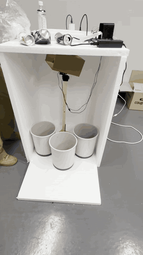
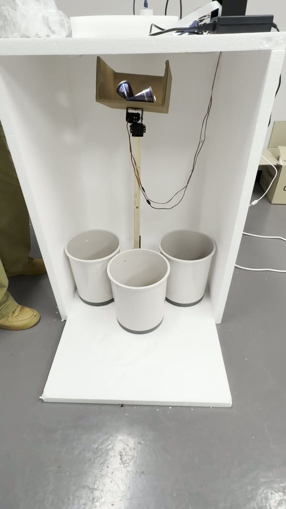
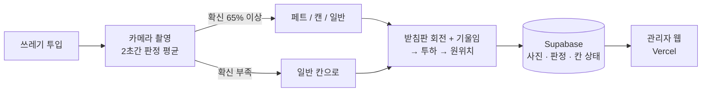
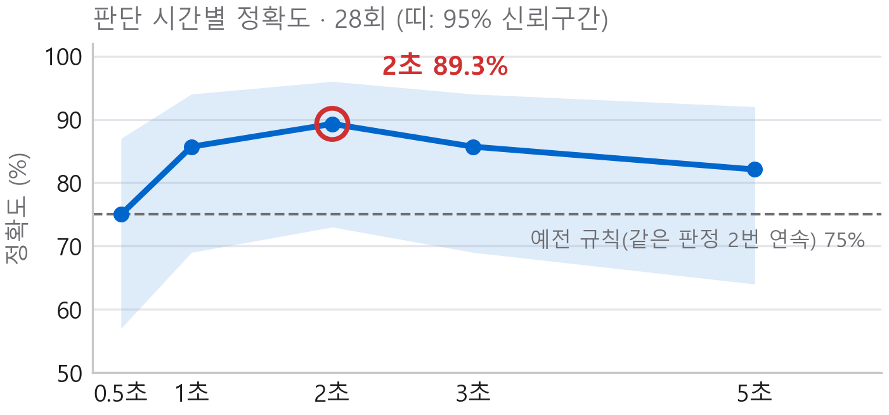
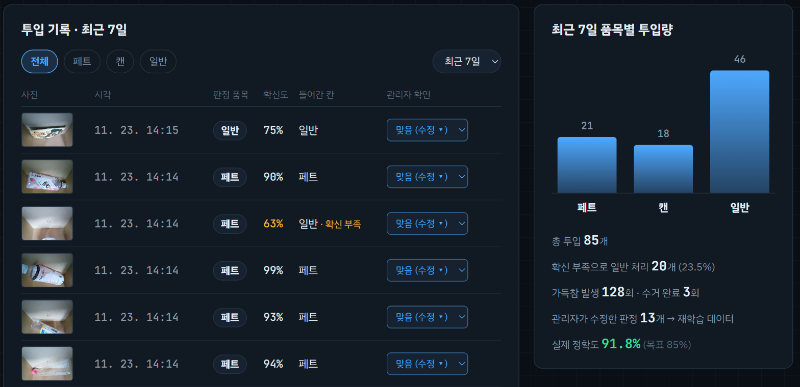
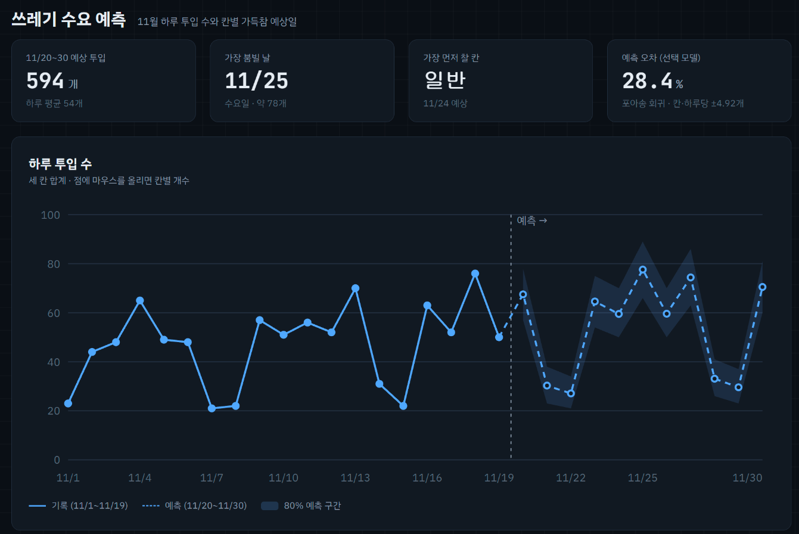
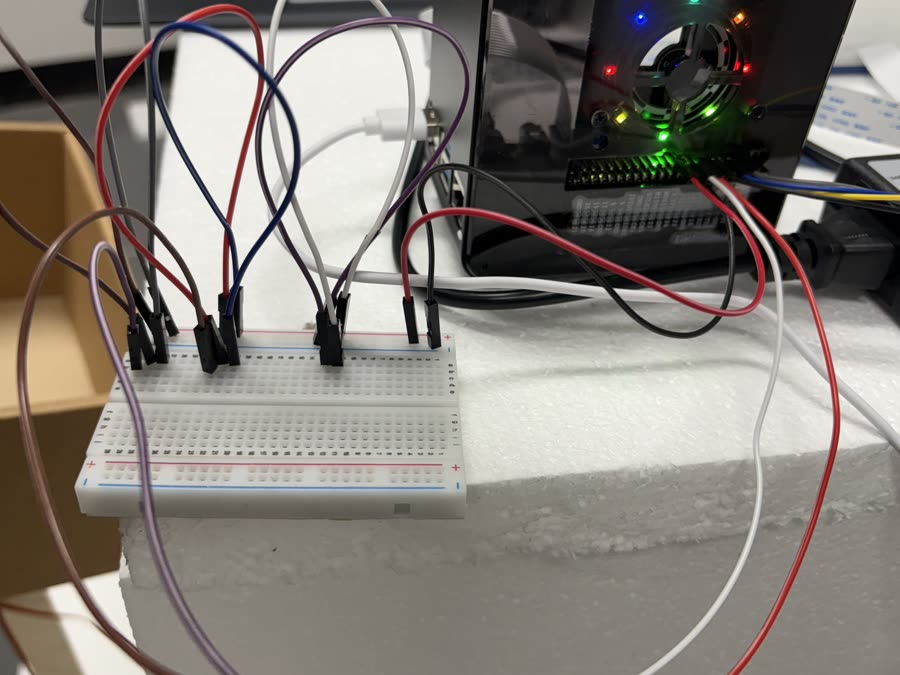
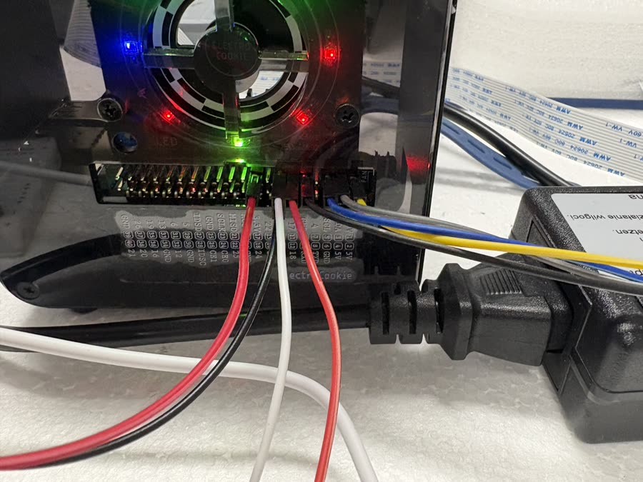

<div align="center">

# ♻️ AI 자동 분리수거함

**쓰레기를 넣으면 카메라와 AI가 페트 · 캔 · 일반을 구분해서 알맞은 칸에 떨어뜨리고,<br>관리자는 웹에서 칸 상태와 투입 기록을 실시간으로 봅니다.**

강남대학교 SP2 팀 프로젝트 · 2026년 2학기 · 부품비 약 10만 원

[](https://ai-trashbin.vercel.app/live)



&nbsp;&nbsp;


<sub>왼쪽: 실제 시연 (2배속) · 오른쪽: 완성된 수거함 — 받침판 위 캔을 보고 판정 중</sub>

</div>

---

## 한눈에 보기

| | |
|---|---|
| **무엇을** | 쓰레기를 스스로 분류해서 버려 주는 수거함 + 관리자용 웹 |
| **어떻게** | 라즈베리파이 카메라 → AI 판정 → 서보모터 2개로 받침판을 **돌리고 기울여** 3개 통 중 하나에 투하 |
| **결과** | 학습에 안 쓴 물건 28회 투입 시험에서 **정확도 89.3%** · 실제 운영 85건 기준 관리자 확인 정확도 **91.8%** |
| **특징** | AI가 확신 65% 미만이면 무조건 일반 칸으로 → 재활용 칸이 오염되지 않게 하는 **안전 로직** |

## 동작 순서



## 내가 한 일 (안한석 · SW·AI 담당)

- **AI 모델** — 수거함 안에서 직접 사진 286장을 찍어 MobileNet 전이학습 → `.tflite`로 라즈베리파이에서 실시간 추론
- **수거함 프로그램** ([code/main.py](code/main.py)) — 투입 감지, 판정, 서보 2개 제어, 투하 후 원위치 보정, IR 센서로 가득참 감지, 부팅 시 자동 실행
- **실험으로 설정값 결정** — "얼마나 오래 보고 판정할까", "확신 몇 % 아래를 버릴까"를 실물로 재서 정함 ([실험 기록](experiments/2026-11-18/README.md))
- **관리자 웹** ([web/](web/)) — Next.js + Supabase. 투입 기록·사진, 칸 상태, 판정 수정, 쓰레기 수요 예측, 로그인 없이 보는 공개 화면
- **재학습 자동화** ([code/retrain.py](code/retrain.py)) — 관리자가 웹에서 고친 판정을 모아 다시 학습 → 시험 점수가 이전 이상일 때만 파이에 반영

## 실험: 근거를 갖고 정한 값들



- **판단 시간 2초** — 0.5초 75% → 2초 **89.3%** → 5초 82%. 오래 본다고 더 정확해지지 않았음
- **확신도 기준 65%** — 70%일 때보다 맞는 칸 비율은 올리고, 재활용 칸 오염은 10%로 가장 낮음
- 초기 모델(사진 95장)은 54%였음 → 오답 대부분이 학습에 없던 일반쓰레기 → **시간이 아니라 데이터**로 해결 ([1차 실험](experiments/2026-11-16/README.md))

## 관리자 웹

**[ai-trashbin.vercel.app/live](https://ai-trashbin.vercel.app/live)** — 로그인 없이 칸 상태와 오늘 투입 수를 볼 수 있는 공개 화면

| 투입 기록 · 판정 확인 | 쓰레기 수요 예측 |
|---|---|
|  |  |
| 사진·판정·확신도를 보고 틀린 판정은 관리자가 고침 → 재학습 데이터 | 날짜별 투입량과 칸별 가득참 예상일 (포아송 회귀, 시연용 가상 데이터) |

## 하드웨어

 

| 부품 | 쓰임 |
|---|---|
| Raspberry Pi 4 (8GB) | 두뇌 — 카메라 판정, 서보 제어, DB 전송 |
| 카메라 ov5647 | 받침판 위 쓰레기 촬영 |
| PCA9685 + 서보 2개 | 받침판 회전(통 방향 조준) + 기울임(투하) |
| IR 장애물 센서 | 칸 가득참 감지 |

## 폴더 구조

```
code/          라즈베리파이 프로그램 (main.py, 학습·실험 스크립트)
web/           관리자 웹 (Next.js 15)
supabase/      DB 테이블 정의 (schema.sql)
experiments/   실험 기록과 그래프
기획서.md · 스펙.md · 설계가이드.md   기획·설계 문서
```

설치 방법은 [SETUP.md](SETUP.md), 용어는 [CONTEXT.md](CONTEXT.md), 결정 이유는 [결정기록.md](결정기록.md)에 있습니다.
