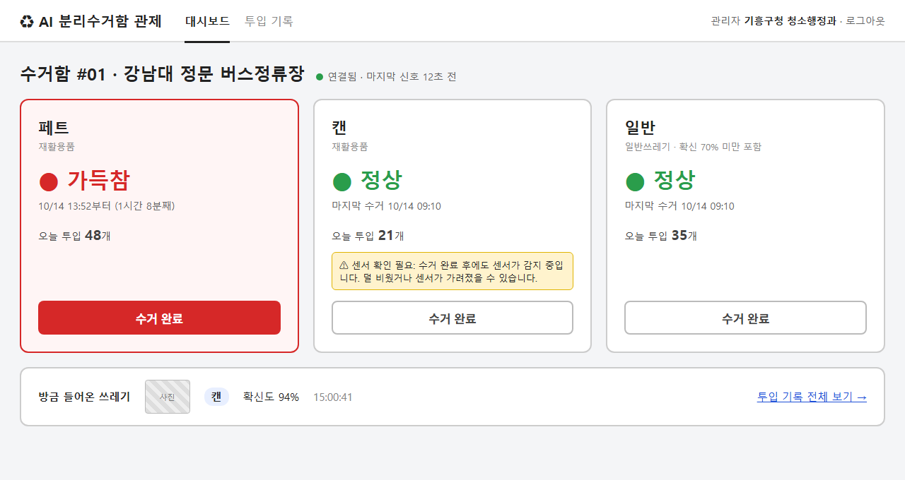
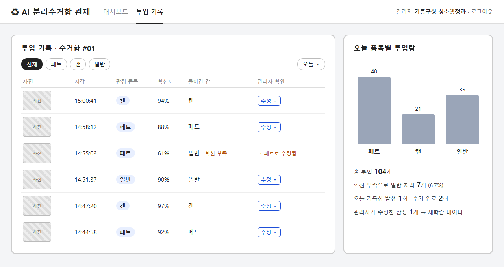
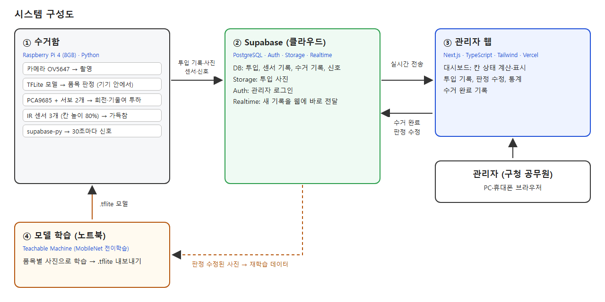

# 기획서 스펙 (양식 1~10번)

한글 양식 `팀플기획서(양식)-서비스개발II.hwp`의 항목 순서를 따른다. 용어는 [CONTEXT.md](CONTEXT.md)를 기준으로 한다.

## 결정 사항

| 항목 | 결정 |
|---|---|
| 방향 | 가정용을 빼고 공공용으로 전환 |
| 주 사용자 | 관리자 (구청 청소행정과 공무원) 한 명뿐 |
| 설치 장소 | 길거리, 버스정류장 (가로 쓰레기통 자리) |
| 핵심 문제 | ① 헛걸음 수거 ② 넘침 민원 ③ 분리배출 오염 |
| 차별점 | AI로 3칸에 나눠 담고 칸별로 가득참 감지 (확장 시 품목별 수거 동선) |
| 이번 범위 | 시험용 수거함 1대: AI 분류 + 칸별 가득참 → 웹 대시보드 |
| 수거 동선 | 만들지 않음. 확장 로드맵에만 씀 |
| 알림 방법 | 대시보드에서 가득참 칸을 빨간색으로 표시 (푸시·문자 없음) |
| 대시보드 수거함 수 | 실물 1대만 (가상 수거함 없음) |
| 가득참 해제 | 관리자가 대시보드에서 "수거 완료"를 누름 |
| 벤치마킹 | 이큐브랩, 수퍼빈 네프론, 구로구 스마트 쓰레기통 |
| 수거 완료 후 센서가 계속 감지 | 정상으로 바꾸고 "센서 확인 필요" 경고 |
| UI 그림 | 그림1 대시보드, 그림2 투입 기록 (HTML 시안 → PNG) |
| 투입 기록 | 사진 + 시각 + 판정 품목 + 확신도 + 들어간 칸 |
| 로그인 | 관리자 계정 1개 (Supabase Auth 이메일 로그인) |
| 수거 완료 버튼 | 가득참이 아니어도 언제든 누를 수 있음 (정기 수거 기록) |
| 연결 상태 | 수거함이 30초마다 신호, 2분 넘게 없으면 "연결 끊김" |
| 판정 수정 | 관리자가 투입 기록에서 고칠 수 있음 → 재학습 데이터, 실제 정확도 계산 |
| 시민 표시 | 없음 |
| 웹 기술 | Next.js + TypeScript + Tailwind, Vercel 배포 |
| 서버 | 따로 없음. Supabase(DB, Auth, Storage, Realtime)만 사용 |
| 상태 판단 위치 | 수거함은 센서 값이 바뀔 때만 기록, 웹이 기록으로 칸 상태 계산 |
| 수거함 인증 | Supabase service_role 키를 파이 환경변수에 둠 (도난 위험은 위험요소에 기록) |
| 학습 방법 | 1차 Teachable Machine → 이후 Colab·Keras MobileNetV2 직접 전이학습, 두 모델 비교 |
| 학습 데이터 | 파이 카메라로 직접 촬영만. 품목당 200장, empty 100장 |
| 정확도 측정 | 시험 사진 20% 혼동행렬 + 실물 투입 품목당 30회 + 판정 수정 기록 |
| 재학습 | 스프린트마다 수동 |
| 추가 구매 | IR 장애물 센서(FC-51 등) 3개 — 가득참 감지용, 부품 목록에 없음 |
| 가득참 기준 | 칸 높이 80% 지점의 IR 센서가 감지하면 가득참 (2단계) |
| 목표 수치 | 품목 3종 분류 정확도 85% 이상 |
| 대박 이유 | 예산 절감, 데이터 자산, 탄소 감축 |
| 팀 | 7조, 팀명 없음. 안동현(202204229), 안한석(202304248) |
| 역할 | HW 안동현, SW 안한석. 발표도 각자 맡은 부분 |
| 팀장 | 안한석 |
| 학술제·논문 | 학술제(11/24) 출품. SP2 데모 + 포스터 |
| 예산 | 자비. 요청사항 없음 |

---

## 표지

| 항목 | 내용 |
|---|---|
| 프로젝트명 | **AI 분리수거함 수거 관제** |
| 부제 | 인공지능서비스개발II 팀 프로젝트 기획서 |
| 날짜 | 2026. 10. 21. |
| 팀명 | (비움) |
| 팀장 | 202304248 안한석 |
| 팀원 | 202204229 안동현 |

---

## 요약

**AI 분리수거함 수거 관제**는 길거리와 버스정류장에 두는 수거함이 쓰레기를 AI로 페트·캔·일반 칸에 나눠 담고, 칸별 가득참을 관리자 웹 대시보드에 실시간으로 알리는 공공 서비스다.

**문제.** 구청은 길거리 쓰레기통이 얼마나 찼는지 현장에 가야 안다. 그래서 ① 덜 찬 통까지 도는 헛걸음 수거, ② 빨리 차는 통의 넘침 민원, ③ 섞여 버려진 쓰레기로 인한 분리배출 오염이 생긴다.

**해결.** 수거함은 넣은 쓰레기를 카메라로 찍고, 라즈베리파이 안의 AI 모델이 품목을 판정한다. 서보 2개가 받침판을 돌리고 기울여 맞는 칸에 넣는다. 확신도가 70% 미만이면 일반 칸으로 보내 재활용 칸의 오염을 막는다. 칸 높이 80% 지점의 IR 센서가 가득참을 감지하면 대시보드의 해당 칸이 빨간색으로 바뀐다. 관리자는 칸을 비운 뒤 "수거 완료"를 누른다.

**차별점.** 기존 스마트 쓰레기통(이큐브랩, 구로구)은 통 하나의 적재량만 보고, 수퍼빈 네프론은 캔·페트만 받는다. 이 서비스는 가로 쓰레기통 하나 안에서 **AI 분리와 칸별 가득참 관리**를 함께 한다. 그래서 재활용품 수거차와 일반쓰레기 수거차 중 어느 쪽을 보낼지 따로 정할 수 있다.

**기술.** Raspberry Pi 4 (8GB), OV5647 카메라, MG996R 서보 2개(PCA9685), IR 센서 3개. MobileNet 전이학습 모델(Teachable Machine → Colab MobileNetV2)을 TensorFlow Lite로 기기에서 실행한다. Supabase(DB, Storage, Auth, Realtime)와 Next.js 관리자 웹을 Vercel에 배포한다.

**목표.** 시험용 수거함 1대로 품목 3종 분류 정확도 85% 이상. 관리자 판정 수정 기록을 재학습에 써서 스프린트마다 정확도를 높인다.

**일정과 역할.** SP2(11/18)에 수거함 완성, 투입 기록, 대시보드 배포, 학술제(11/24) 출품, SP3(12/9)에 가득참·수거 완료·판정 수정·직접 학습 모델을 완성한다. 안동현(HW)이 수거함 제작과 실물 시험을, 안한석(SW)이 AI 모델과 웹을 맡는다. 예산은 자비 약 11만 원이다.

**기대 효과.** 수거 예산 절감, 넘침 민원 감소, 재활용률 향상, 품목별 배출 데이터 축적, 수거차 운행 감소에 따른 탄소 감축.

---

## 1. 개발 배경 및 필요성

### 배경

길거리 쓰레기통은 구청이 직접 관리한다. 수거차는 정해진 요일과 순서대로 모든 쓰레기통을 돈다. 통이 비어 있어도 들르고, 이미 넘친 통도 차례가 올 때까지 기다린다. 통 안에는 페트, 캔, 일반쓰레기가 섞여 있어 재활용으로 이어지기 어렵다.

### 필요성

1. **헛걸음 수거.** 관리자는 통이 얼마나 찼는지 현장에 가야 안다. 그래서 수거차는 덜 찬 통까지 모두 들르고, 연료와 인력이 낭비된다.
2. **넘침 민원.** 반대로 빨리 차는 통은 수거 순서가 오기 전에 넘친다. 주변이 더러워지고 민원이 들어온 뒤에야 대응하게 된다.
3. **분리배출 오염.** 길거리에서는 분리배출 규칙을 지키기 어렵다. 한 칸에 섞여 들어가면 그 묶음 전체가 재활용되지 못한다.

### 개발 동기

세 문제는 "통 안에 무엇이 얼마나 들어 있는지 모른다"는 한 가지 원인에서 나온다. 수거함이 넣는 순간 품목을 나누고, 칸이 차면 스스로 알리면 세 문제를 함께 해결할 수 있다.

### 기존 아이디어와의 차별점

적재량 센서로 수거 경로를 짜 주는 스마트 쓰레기통은 이미 있다. 하지만 이 제품들은 **통 하나의 적재량**만 본다. 이 서비스는 수거함이 AI로 쓰레기를 페트·캔·일반 칸에 나눠 담고, **칸별로** 가득참을 감지한다. 그래서 관리자는 재활용품 수거차와 일반쓰레기 수거차 중 **어느 쪽을 보내야 하는지** 따로 알 수 있다. 수거함이 늘어나면 이 정보로 품목별 수거 동선을 계산하는 데까지 확장할 수 있다.

---

## 2. 개발 목표

### 해결하려는 문제

관리자가 현장에 가지 않고도 **어느 수거함의 어느 칸이 가득참인지** 알게 한다. 동시에 시민이 아무렇게나 넣어도 수거함이 품목별로 나눠 담게 한다.

### 이번 학기 목표 (시험용 수거함 1대)

1. **AI 자동 분리**: 넣은 쓰레기를 카메라로 찍고 AI가 페트·캔·일반 중 하나로 판정해 맞는 칸에 넣는다. 확신이 70% 미만이면 일반 칸으로 보낸다.
2. **가득참 알림**: 칸 높이 80% 지점에 단 IR 센서가 쓰레기를 감지하면 그 칸을 가득참으로 기록한다.
3. **관리자 웹 대시보드**: 관리자가 웹에서 칸별 가득참 여부와 품목별 투입 기록을 실시간으로 본다. 가득참 칸은 빨간색으로 표시한다. 칸을 비운 뒤 관리자가 "수거 완료"를 누르면 가득참이 풀린다.
4. **목표 수치**: 품목 3종 분류 정확도 85% 이상.

### 확장 로드맵 (이번 학기에는 만들지 않음)

- 수거함을 여러 대 설치하고 지도에 표시한다.
- 가득참 칸이 있는 수거함만 골라 들르는 **수거 동선**을 품목별로 계산한다.

### 서비스 대상

- **관리자**: 구청 청소행정과 공무원. 관할 지역의 길거리, 버스정류장 수거함을 관리한다.

### 대박 이유

1. **예산 절감.** 덜 찬 수거함에 들르는 헛걸음 수거가 줄어 연료비와 인건비가 줄어든다.
2. **데이터 자산.** 어느 지역에서 어떤 품목이 언제 많이 버려지는지 쌓인다. 수거함 배치와 수거 주기를 정하는 정책 근거가 된다.
3. **탄소 감축.** 수거차 운행 거리가 줄어 지자체의 탄소중립 정책 목표와 맞는다.

---

## 3. 벤치마킹

| 서비스 | 내용 | 공통점 (참고할 점) | 차별점 (우리가 다른 점) |
|---|---|---|---|
| **이큐브랩** CleanCUBE·CleanCityNetworks (한국) | 태양광 압축 쓰레기통과 초음파 적재 센서. 관제 플랫폼에서 적재량 이력을 보고 수거 경로를 최적화한다. 60여 개국 300여 개 도시에서 쓴다 | 적재 상태를 원격으로 보고 수거를 계획하는 관제 방식 | 통 하나의 적재량만 본다. 우리는 AI로 3칸에 나눠 담고 **칸별로** 가득참을 본다 |
| **수퍼빈 네프론** (한국) | 이미지로 캔·페트를 판별해 회수하는 AI 로봇. 개당 10포인트를 준다. 2022년 5월 기준 전국 400대 이상 | 투입 → AI 판별 → 처리로 이어지는 흐름 | 캔·페트만 받고 일반쓰레기는 거절한다. 우리는 일반쓰레기까지 받는 **가로 쓰레기통**이고, 칸 상태를 관리자에게 보여 준다 |
| **구로구 스마트 쓰레기통** (2019) | 구청 사거리, 신도림, 개봉역 3곳에 설치. 앱으로 실시간 적재량을 보고, 가득 차면 모바일 알림을 받는다 | 구청이 직접 운영하는 가로 쓰레기통 관제. 우리 서비스 대상과 같다 | 분리 기능이 없다. 우리는 분리와 칸별 가득참 관리를 함께 한다 |

**정리:** 기존 사례는 "통 하나의 적재량 감지"(이큐브랩, 구로구)와 "품목 판별"(네프론) 중 하나만 한다. 가로 쓰레기통 하나 안에서 AI로 3칸에 나누고 칸별 가득참을 관리자 대시보드로 보여 주는 공개 사례는 조사한 범위에서는 찾지 못했다.

**참고 자료**
- 이큐브랩: https://www.ecubelabs.com/waste-analytics-platform/ , https://www.mt.co.kr/future/2024/09/10/2024090216460383546
- 수퍼빈 네프론: https://www.fnnews.com/news/202205130939327294 , https://gangdong.go.kr/web/newportal/press/10530
- 구로구: https://www.smarttoday.co.kr/ko-kr/articles/1537
- (2번 대박 이유 근거) Bigbelly 수거 횟수 80% 이상 감소 주장: https://bigbelly.com/solutions/reduced-collections

---

## 4. 예상 결과물 UI

시안 파일: `wireframe/1-dashboard.png`, `wireframe/2-log.png` (원본 HTML은 같은 폴더)

### 그림1. 대시보드 (웹)

**설명:** 관리자가 로그인하면 처음 보는 화면이다. 수거함 이름, 설치 위치, 연결 상태가 맨 위에 있다. 페트·캔·일반 칸마다 카드 하나씩 상태를 보여 준다. 가득참 칸은 카드 전체가 빨간색으로 바뀌고, 언제부터 가득찼는지와 "수거 완료" 버튼이 나온다. 관리자가 칸을 비우고 수거 완료를 눌렀는데 센서가 계속 감지하면 "센서 확인 필요" 경고가 뜬다. 맨 아래에는 방금 들어온 쓰레기의 사진, 판정 품목, 확신도가 실시간으로 표시된다.

### 그림2. 투입 기록 (웹)

**설명:** 수거함에 들어온 쓰레기를 시간순으로 보여 준다. 줄마다 카메라 사진, 시각, AI가 판정한 품목, 확신도, 실제로 들어간 칸이 나온다. 확신도가 70% 미만이라 일반 칸으로 보낸 경우는 "확신 부족"으로 표시해서 관리자가 사진으로 오분류를 확인할 수 있다. 오른쪽에는 오늘 품목별 투입량 그래프와 가득참, 수거 완료 횟수가 나온다.

---

## 5. 주요 기능

| 주요 기능 | 세부 설명 |
|---|---|
| **투입 감지** | 받침판 위를 카메라가 계속 본다. 같은 판정이 확신도 60% 이상으로 2번 연속 나오면 쓰레기가 들어온 것으로 본다. 나중에 초음파 센서를 달면 센서 감지로 바꿀 수 있다. |
| **AI 품목 판정** | 받침판 위 쓰레기를 촬영하고, 라즈베리파이 안에서 TFLite 모델로 페트·캔·일반 중 하나를 판정한다. 인터넷 없이도 판정한다. 확신도가 70% 미만이면 판정 품목과 상관없이 일반 칸으로 보낸다. 재활용 칸이 오염되지 않게 하기 위해서다. |
| **자동 투하** | 회전 서보가 받침판을 해당 칸 방향으로 돌리고, 기울임 서보가 받침판을 기울여 쓰레기를 떨어뜨린 뒤 원위치로 돌아온다. 서보 2개로 3칸을 처리한다. |
| **가득참 감지** | 칸 높이 80% 지점에 단 IR 센서가 쓰레기를 감지하면 그 칸을 가득참으로 바꾼다. 가득참은 관리자가 수거 완료를 누를 때까지 유지된다. 쓰레기가 흔들려 센서가 깜빡여도 표시가 오락가락하지 않는다. |
| **상태 전송** | 수거함은 투입마다 사진, 판정 품목, 확신도, 들어간 칸을 클라우드 DB로 보낸다. 칸별 센서 상태와 연결 신호(30초마다)도 보낸다. 인터넷이 끊겨도 분리와 투하는 계속 동작한다. |
| **관리자 로그인** | 관리자 계정 하나로 이메일 로그인한다. 로그인하지 않으면 대시보드를 볼 수 없고 수거 완료도 누를 수 없다. |
| **대시보드** | 칸 3개의 상태(정상/가득참)를 실시간으로 보여 준다. 가득참 칸은 빨간색으로 표시한다. 관리자는 칸을 비운 뒤 언제든 수거 완료를 누를 수 있고, 그 시각이 수거 기록으로 남는다. 수거 완료 후에도 센서가 계속 감지하면 "센서 확인 필요" 경고를 띄운다. 신호가 2분 넘게 없으면 "연결 끊김"으로 표시한다. |
| **투입 기록과 판정 수정** | 투입을 시간순으로 사진과 함께 보여 준다. 관리자는 사진을 보고 오분류를 고칠 수 있다. 고친 기록은 재학습 데이터로 모으고, 실제 분류 정확도를 계산하는 데 쓴다. 품목별 투입량 그래프와 가득참, 수거 완료 횟수도 보여 준다. |

---

## 6. 시스템 구조

시안 파일: `wireframe/3-architecture.png`

| 구성요소 | 설명 | 개발 환경 및 구현 방법 |
|---|---|---|
| **수거함** | 쓰레기를 촬영해 품목을 판정하고 맞는 칸에 넣는다. 칸별 IR 센서 값이 바뀌면 기록하고, 30초마다 연결 신호를 보낸다. 판정은 기기 안에서 하므로 인터넷이 끊겨도 분리는 계속된다. | Raspberry Pi 4 (8GB), Python. 카메라 OV5647(picamera2), 서보 MG996R 2개와 PCA9685(adafruit-servokit), IR 장애물 센서 3개(gpiozero). Supabase 접속은 supabase-py, 키는 환경변수로 넣는다 |
| **AI 모델** | 사진 한 장을 받아 페트·캔·일반 확률을 낸다. | Teachable Machine에서 MobileNet 전이학습 후 TensorFlow Lite(.tflite)로 내보내 파이에서 실행 |
| **DB** | 투입, 센서 기록, 수거 기록, 신호를 쌓는다. 칸 상태는 따로 저장하지 않고 기록으로 계산한다. | Supabase PostgreSQL |
| **사진 저장소** | 투입 사진을 저장한다. 판정 수정된 사진은 재학습 데이터가 된다. | Supabase Storage |
| **로그인** | 관리자 계정 1개로 이메일 로그인한다. 로그인한 관리자만 기록을 보고 수거 완료, 판정 수정을 할 수 있다. | Supabase Auth, 행 단위 보안(RLS) |
| **실시간 전달** | 새 투입이나 센서 기록이 생기면 새로고침 없이 웹에 바로 반영한다. | Supabase Realtime |
| **관리자 웹** | 기록으로 칸 상태(정상, 가득참, 센서 확인 필요, 연결 끊김)를 계산해 보여 준다. 수거 완료와 판정 수정을 DB에 기록한다. | Next.js, TypeScript, Tailwind CSS. Vercel에 배포 |

**칸 상태 계산 규칙 (웹)**
- 마지막 수거 완료 뒤에 센서가 감지로 바뀐 적이 있으면 **가득참**
- 수거 완료를 누른 시점에 센서가 감지 중이었고 지금도 감지 중이면 **센서 확인 필요**
- 마지막 신호가 2분 넘게 없으면 **연결 끊김**
- 그 밖에는 **정상**

---

## 7. 개발 방법론

### 7-1. 학습 데이터

- **직접 촬영:** 완성한 수거함의 받침판 위에 실제 쓰레기를 올리고 파이 카메라(640×480)로 찍는다 (`capture.py`). 학습할 때와 실제로 쓸 때의 카메라, 조명, 배경, 각도가 같아야 정확도가 나오기 때문에 공개 데이터셋은 쓰지 않는다.
- **클래스 4개:**

| 클래스 | 뜻 | 사진 수 | 예시 |
|---|---|---|---|
| plastic | 품목 페트 | 200장 | 생수병, 음료병 등 10~20개를 여러 각도로 |
| can | 품목 캔 | 200장 | 음료캔, 맥주캔 등 10~20개를 여러 각도로 |
| general | 품목 일반 | 200장 | 종이컵, 휴지, 비닐, 과자봉지, 영수증 등 여러 종류를 섞음 |
| empty | 받침판이 비어 있음 (품목 아님, 투입 감지용) | 100장 | 빈 받침판, 조명 변화 |

- **운영 중 데이터:** 관리자가 판정 수정한 투입 사진은 정답이 붙은 새 학습 데이터가 된다.

### 7-2. 알고리즘

- **MobileNet 계열 CNN 전이학습.** ImageNet으로 미리 학습된 MobileNet의 특징 추출부를 그대로 쓰고, 마지막 분류층만 4개 클래스로 새로 학습한다. 적은 사진(클래스당 수백 장)으로도 높은 정확도를 낼 수 있다. 모델이 가벼워 라즈베리파이에서 1초 안에 판정할 수 있다.
- **안전 로직:** 판정 품목의 확신도가 70% 미만이면 일반 칸으로 보낸다. 페트·캔 칸의 오염을 막는다.
- **투입 감지:** 카메라로 계속 판정하다가 empty가 아닌 같은 결과가 확신도 60% 이상으로 2번 연속 나오면 투입으로 본다. 센서 없이 카메라만으로 감지한다.

### 7-3. 학습 방법 (2단계)

1. **1차 스프린트, Teachable Machine:** 웹에서 사진을 올려 MobileNet 전이학습 후 TensorFlow Lite(.tflite)로 내보낸다. 빠르게 수거함 전체를 동작시키는 것이 목적이다.
2. **2차 스프린트 이후, 직접 학습:** Google Colab에서 Keras로 MobileNetV2 전이학습을 직접 코딩한다. 데이터 증강(회전, 밝기, 좌우 반전), 학습률, 에포크를 조정하고 .tflite로 변환한다. 1단계 모델과 정확도, 판정 시간을 비교한다.
3. **재학습:** 스프린트마다 판정 수정 사진을 학습 데이터에 더해 다시 학습하고, 재학습 전후 정확도를 비교한다.

### 7-4. 성능 측정 (목표: 품목 3종 정확도 85% 이상)

| 측정 | 방법 | 보여 주는 것 |
|---|---|---|
| 모델 정확도 | 학습에 쓰지 않은 사진 20%로 시험하고 혼동행렬을 그린다 | 어떤 품목끼리 헷갈리는지 |
| 수거함 정확도 | 품목당 30번씩 실물을 넣어 맞는 칸에 들어간 비율을 센다 | 촬영, 판정, 투하까지 전체 성능 |
| 실제 정확도 | 운영 중 투입 가운데 관리자가 판정 수정하지 않은 비율 | 실제 사용 환경 성능 |

### 7-5. 사용하는 API와 라이브러리

| 이름 | 용도 |
|---|---|
| Teachable Machine, TensorFlow/Keras (Colab) | 모델 학습 |
| TensorFlow Lite 런타임 (ai-edge-litert) | 파이에서 판정 |
| picamera2, gpiozero, adafruit-servokit | 카메라, IR 센서, 서보 제어 |
| supabase-py, supabase-js | DB, 사진 저장, 로그인, 실시간 전송 |
| Next.js, Tailwind CSS, Vercel | 관리자 웹 개발과 배포 |

---

## 8. 팀원 역할분담 (R&R)

| 팀원 | 역할 및 할 일 |
|---|---|
| **안동현** (202204229) **HW 담당** | 수거함 제작 전체를 맡는다. 부품 검수, 우드락 통(3칸)과 기둥·받침판 조립, 라즈베리파이·PCA9685·서보·카메라·LED 배선, 서보 각도 실측(`config.py`의 `BINS`), 칸 높이 80% 지점 IR 센서 3개 설치. 학습 사진 촬영(품목당 200장, empty 100장)과 실물 투입 정확도 시험(품목당 30회)도 맡는다. 발표: 수거함 구조, 동작 시연, 수거함 정확도 결과 |
| **안한석** (202304248) **SW 담당, 팀장** | 소프트웨어 전체와 일정 관리를 맡는다. Teachable Machine 학습과 Colab MobileNetV2 직접 학습, 파이 코드(`main.py`: 판정, 투하, Supabase 전송, 연결 신호), Supabase(DB, Storage, Auth, Realtime) 구성, 관리자 웹(Next.js) 개발과 Vercel 배포, 혼동행렬 분석. 발표: AI 모델, 시스템 구조, 관리자 웹 |

두 사람이 함께 하는 일: 통합 시험(투입 → 판정 → 투하 → 웹 반영), 학술제 포스터, 스프린트 발표 자료.

---

## 9. 일정 (소요 예산, 요청사항 포함)

### 평가 일정

| 날짜 | 평가 | 배점 |
|---|---|---|
| 10/21 | 기획서 발표 | 20점 |
| 11/18 | SP2 발표 | 15점 |
| 11/24 | 학술제 출품 (필수) | – |
| 12/9 | SP3 발표 | 25점 |

### 스프린트별 프로토타입

| 스프린트 | 기간 | 완성할 기능 |
|---|---|---|
| **기획** | ~10/21 | 기획서, UI 시안, 시스템 구성도. 부품 도착 검수, 라즈베리파이 세팅 |
| **SP2** | 10/22~11/18 | 수거함 완성(분류 → 회전·기울임 투하), Teachable Machine 모델, 투입 기록(사진, 품목, 확신도, 칸) 전송, 관리자 웹 로그인·대시보드·투입 기록 화면 배포 |
| **학술제** | 11/19~11/24 | SP2 데모를 그대로 출품하고 포스터를 추가 |
| **SP3** | 11/25~12/9 | IR 가득참 감지, 수거 완료, 센서 확인 필요, 연결 끊김, 판정 수정, Colab 직접 학습 모델, 재학습 전후 정확도 비교 |

### 주차별 계획

| 기간 | HW (안동현) | SW (안한석) |
|---|---|---|
| ~10/21 | 부품 검수, 다이소·철물점 장보기, IR 센서 주문, 파이 세팅 | 기획서 완성, Supabase 프로젝트 생성 |
| 10/22~11/4 | 서보 테스트, 우드락 통·기둥·받침판 조립, 카메라·LED 거치, 배선, 각도 실측 | DB 테이블·Storage·Auth 구성, 웹 로그인·대시보드 뼈대, `main.py` 투입 기록 전송 |
| 11/5~11/17 | 학습 사진 촬영, 실물 투입 시험(품목당 30회) | Teachable Machine 학습·적용, 투입 기록 화면, Vercel 배포, 통합 시험 |
| 11/18 | **SP2 발표** | |
| 11/19~11/24 | 학술제 포스터, 시연 준비 (함께) | |
| 11/25~12/8 | IR 센서 3개 설치(칸 높이 80%), 투명 페트 감지 확인, 실물 정확도 재시험 | 가득참·수거 완료·센서 확인 필요·연결 끊김, 판정 수정, Colab MobileNetV2 학습, 재학습 전후 비교 |
| 12/9 | **SP3 발표** | |

### 소요 예산 (자비)

| 항목 | 금액 |
|---|---|
| 알리익스프레스 부품 17종 ([설계가이드.md](설계가이드.md) 부품 목록) | 약 106,000원 |
| IR 장애물 센서 3개 (FC-51 등) | 약 3,000원 |
| **합계** | **약 109,000원** |

라즈베리파이 4(8GB, 팬 케이스 포함), 노트북, 핸드폰 거치대는 가지고 있는 것을 쓴다. 나무 재단과 우드락 등 소모품 비용은 예산에서 제외한다. 웹과 DB는 Supabase, Vercel 무료 요금제로 충분하다.

### 요청사항

없음.

---

## 10. 기대 효과 및 활용 분야

### 기대 효과

1. **수거 예산 절감.** 관리자가 가득참 칸이 있는 수거함만 골라 수거할 수 있다. 덜 찬 통에 들르는 헛걸음 수거가 줄어 연료비와 인건비가 줄어든다.
2. **넘침 민원 감소.** 칸이 차는 즉시 대시보드에 빨간색으로 표시되므로, 넘쳐서 민원이 들어오기 전에 수거할 수 있다.
3. **재활용률 향상.** 시민이 분리배출 규칙을 몰라도 수거함이 페트·캔·일반으로 나눠 담는다. 확신이 낮으면 일반 칸으로 보내 재활용 칸의 오염을 막는다.
4. **정책 데이터 축적.** 어느 장소에서 어떤 품목이 언제 많이 버려지는지 기록이 쌓인다. 수거함 배치, 수거 주기, 재활용 캠페인을 정하는 근거가 된다.
5. **탄소 감축.** 수거차 운행 거리가 줄어 지자체 탄소중립 목표에 기여한다.

### 활용 분야

- **지자체 가로 쓰레기통:** 길거리, 버스정류장 (이번 서비스의 주 대상)
- **공공시설:** 공원, 지하철역, 관광지
- **캠퍼스·사무 단지:** 대학, 공공기관, 대형 건물의 공용 쓰레기통
- **행사장:** 축제, 공연장처럼 짧은 시간에 쓰레기가 몰리는 곳

---

## 11. 위험 요소와 대응

| 위험 요소 | 영향 | 대응 |
|---|---|---|
| **IR 센서가 투명 페트를 못 볼 수 있음** | 페트 칸이 차도 가득참이 안 뜸 | 조립 단계(SP2)에서 투명 페트로 먼저 시험한다. 감지가 약하면 센서 맞은편 벽에 흰 반사판을 붙이거나 초음파 센서로 바꾼다 |
| **service_role 키 도난** | 파이를 잃어버리면 DB 전체에 접근 가능 | 키는 `.env`에만 두고 깃허브에 올리지 않는다(.gitignore). 분실하면 Supabase에서 즉시 키를 재발급한다 |
| **시간 부족** | SP3 기능 일부 미완성 | SP2에 핵심 흐름(분류, 투하, 기록, 대시보드)을 먼저 끝낸다. SP3는 가득참 → 수거 완료 → 판정 수정 순으로 우선순위를 둔다 |
| **조명·배경 변화로 정확도 저하** | 실제 판정이 학습 때보다 틀림 | LED를 항상 켜 조명을 고정하고, 조립을 끝낸 수거함에서만 학습 사진을 찍는다. 카메라 위치가 바뀌면 다시 촬영한다 |
| **서보 각도 오차, 고장** | 쓰레기가 다른 칸에 떨어짐 | 각도는 `config.py`에서 실측값으로 조정한다. 서보와 PCA9685 여분을 1개씩 준비해 두었다 |

---

## 이어서 할 일 (2026-10-14 갱신)

**진행:** 표지, 요약, 1~11번 완료. 팀장 안한석 확정, 예산은 나무·다이소 제외. 팀원 답변 반영(7조, 팀명 없음, HW 안동현·SW 안한석, 학술제 출품, 4·5번은 추천안).

남은 일:
1. **한글 양식에 옮기기:** `팀플기획서(양식)-서비스개발II.hwp`에 1~11번을 옮기고, 파란 안내 글씨와 [별첨] 페이지를 지운다. 11번 위험 요소는 양식에 없는 항목이라 10번 뒤에 추가한다.
